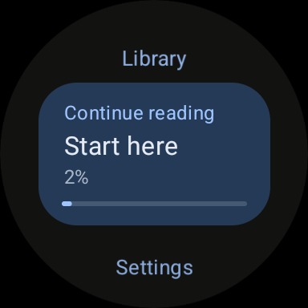
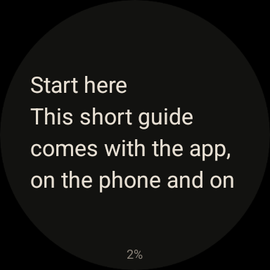
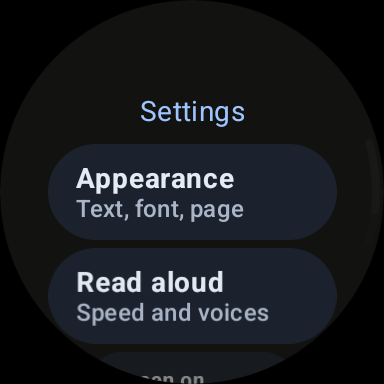
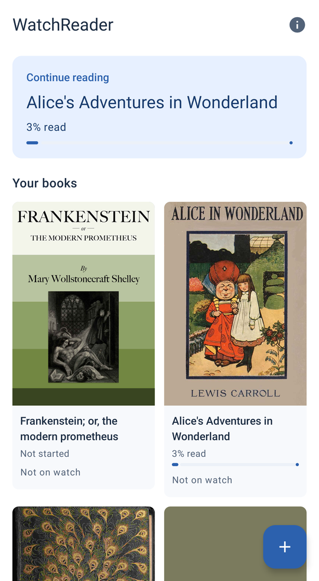
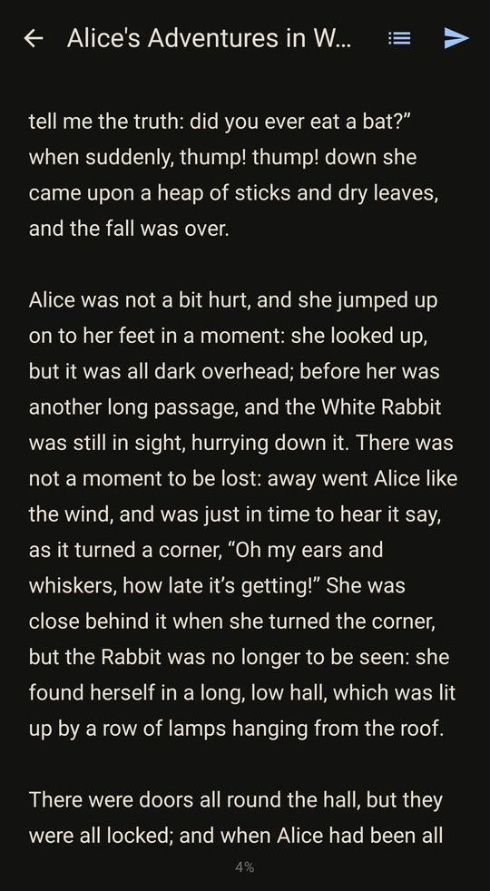
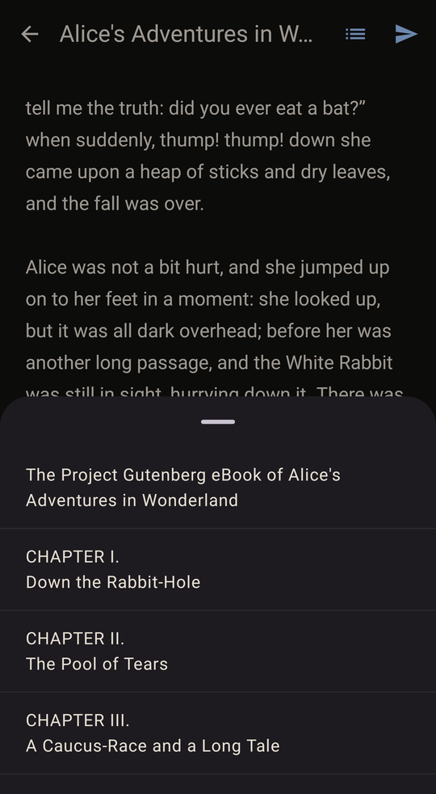

# WatchReader

A minimalist e-book reader for Wear OS with a companion phone app. Add a book on your phone, read it on your watch or on the phone itself, and let either of them read it aloud.

[**Get it on Google Play**](https://play.google.com/store/apps/details?id=com.watchreader)

<p align="center">
  
  
  
</p>

<p align="center">
  
  
  
</p>

## Features

### Both devices

- **Measured pagination**: each line is measured against the real page box with a `TextMeasurer` and broken where the platform breaks it; only the pages you look at are ever measured, so a long novel opens at 90% instantly, and the page before is found by binary search for the start whose page ends exactly where this one begins. On the round watch screen the page is a left-aligned block inscribed in the circle, so no line is clipped
- **Read aloud**: a `mediaPlayback` foreground service reads the book sentence by sentence with the system's TTS engine, each sentence in the language it is written in (scripts such as Chinese, Japanese, Korean, Cyrillic, Greek, Arabic, Hebrew, Thai and Devanagari sentence by sentence, and the language of Latin-script text once for the whole book), and keeps going with the screen off or after you leave the reader. The reader follows along and highlights the sentence. A sleep timer stops it after 15 to 60 minutes. The engine is started and shut down off the main thread, because a cold start on a watch takes seconds
- **Auto page turn**, from slow to fast; reading aloud and auto page turn stop each other
- **Bookmarks**, kept in step between phone and watch, deletions included
- **Progress both ways**: whichever device you read on keeps the place and tells the other; the later reading wins. The phone offers, rather than forces, a newer place read on the watch while a book is open
- **Contents**: the book's own table of contents for EPUB and FB2, headings found in the text for plain text; a jump can be undone

### Phone

- **Formats**: `.txt`, `.epub` (EPUB 2 and 3, with cover and contents; DRM-protected books are refused with a reason) and `.fb2`, zipped or not. Plain-text encodings are detected on the phone (byte-order marks, UTF-16 without one, UTF-8, GB18030/GBK, Big5, Shift_JIS, and the Windows and KOI8 code pages of Europe), and lines a Latin-script file was hard-wrapped at are joined back into paragraphs, so the watch only ever stores clean UTF-8
- **Adding books**: from the file picker (several at once), by sharing a file or a link to WatchReader, by pasting a link, or from **Discover**, a catalogue of free Project Gutenberg books, which a library holding only the bundled guide points to
- **Library**: covers, authors, progress, whether each book is on the watch and why a send failed, a Continue reading card, search and filters, and a listening bar above the tabs while a book is read aloud
- **Reader**: tap the halves to turn pages, a contents sheet with a go-to slider, full-text search, bookmarks, and a way back to where you were before a jump. Up to six fonts (Sans, Serif, Hei and Song where the phone has Noto CJK, the bundled Kai, and Literata), text size, line spacing and margins
- **Highlights and notes**: press and hold to select words, drag the handles, highlight in four colours, add a note, look the words up in a dictionary app or translate them, and export a book's highlights and notes as Markdown
- **Read aloud on the phone**: a media session for the notification, the lock screen and headset buttons, audio focus, a pause when headphones come out, voice choice per language, and a sleep timer that can stop at the end of the chapter
- **Reading time**: per book and per day, for reading on the phone, reading on the watch and listening

### Watch

- **Rotary crown**: one page per detent in the reader, scrolling in lists
- **Reader controls**: long-press the page for read-aloud, the contents, a go-to slider, bookmarks and undoing a jump; a double tap pauses reading aloud
- **Settings**: text size, up to five fonts shown in themselves (Sans, Serif, Hei and Song where the watch has Noto CJK, and the bundled 楷体 LXGW WenKai), a dark or sepia page, top and bottom and side margins, each editor with a preview of the reading page; read-aloud speed and which voices the watch has; auto page turn speed; keep the screen on while reading

## Architecture

```
WatchReader/
├── shared/                Library used by both apps; plain Kotlin apart from the Data Layer
│                          objects (*Sync, PendingDeletes, BookmarkRepository)
│   ├── TextNormalizer     Encoding detection, line endings, unwrapping hard-wrapped text
│   ├── BookToc            Contents: the stored list, or headings found in the text
│   ├── BookTransfer, BookMetadata, BookReceipt, BookContents, DataLayerPaths
│   │                      The phone-to-watch wire format and Data Layer paths
│   ├── ProgressDataSync, PendingDeletes, ResentBookProgress
│   ├── reader/            PageGeometry, Paginator, JumpHistory
│   ├── search/            BookSearch (literal, case-insensitive) and ReaderSearch
│   ├── bookmark/          Bookmark records, file store, codec, Data Layer sync
│   ├── stats/             ReadingClock, ReadingReport, ReadingStatsSync
│   └── assets/, res/font/ The bundled guide and the LXGW WenKai font
├── mobile/                Phone app (Jetpack Compose)
│   ├── util/              EpubParser, Fb2Parser, ZipEntries
│   ├── data/              Room database (books, reading time) and repositories, Gutenberg catalogue
│   ├── service/           BookSender, BookTransferWorker, WearSyncService, ReadAloudService
│   ├── transfer/          TransferRunner, the send state machine the worker drives
│   ├── tts/               Sentences, languages, voices, media session, audio focus, sleep timer
│   ├── highlight/         Highlights and notes, selection, export, hand-off to other apps
│   └── ui/                Library, Discover, stats, details, add, reader
└── wear/                  Watch app (Compose for Wear OS)
    ├── service/           BookReceiverService (Data Layer), TtsService (foreground read-aloud)
    ├── tts/               Sentence splitting, language detection, playback state, sleep timer
    ├── reader/            Page margins and typefaces
    ├── ui/                Library, reader, settings
    └── data/              Room database and repository
```

Both apps ship the same `applicationId`, because Play wants every bundle of one listing to carry it; the watch bundle is told apart by `uses-feature android.hardware.type.watch` in its manifest.

Every position in a book (reading progress, bookmarks, highlights, search hits, the sentence being read aloud, chapter starts) is a character offset, in UTF-16 units, into the book's normalised text. A book's text never changes once imported (only the bundled guide is rewritten by an update), so these offsets mean the same thing on both devices and through every change of font, size and margins.

## How the phone and watch talk

Everything goes over the Wearable Data Layer. Each app advertises a capability (`watchreader_phone` and `watchreader_wear`, in `res/values/wear.xml`), and the phone only sends to a node that advertises the watch's.

| What | How | Path |
| --- | --- | --- |
| A book | `ChannelClient` stream: one line of `BookMetadata` JSON, a newline, then the UTF-8 text | `/book/<id>` |
| Its receipt | Message from the watch, a `BookReceipt` JSON | `/book_received` |
| Contents too long for the 64 KiB header | Message from the phone after the receipt, a `BookContents` JSON | `/contents` |
| Reading progress | A data item per node and book, plus a message for an immediate update | `/reading-progress/<id>`, `/progress` |
| Bookmarks | A data item per bookmark, deletions kept as tombstones | `/reader-bookmarks/v1/<hash>/<offset>` |
| The watch's reading time | A data item per book holding its whole history | `/reading-time/<id>` |
| Deleting a book | A message from the phone, and a data item left for a watch out of reach | `/delete_book`, `/pending-delete/<id>` |
| A book deleted on the watch | Message from the watch, also the answer to a pending delete | `/book_removed` |

A send is durable work: `BookTransferWorker` runs one unique WorkManager job per book, and the book's status moves through NOT_SENT, QUEUED, SENDING, SENT and FAILED. The watch writes the stream to `<id>.part`, checks that it received exactly the bytes the header announced, renames it into place and answers with a receipt; a send without a receipt within 90 seconds goes back to the queue, and queued sends start again when the watch reconnects. Progress carries the time of the reading, and each side applies a reading only when it is at least as recent as the one it has. A book sent again keeps its place, moved in proportion when its text changed length.

## Where a reader's data is kept

Each app keeps its books as UTF-8 text in `filesDir/books/<id>.txt` (the phone adds `<id>.cover`, the watch `<id>.txt.toc.json` for the contents) and the library, places and reading time in a Room database. Bookmarks live in `filesDir/reader-bookmarks/bookmarks-v1.json` on both devices, apart from the books and keyed by the book's id, so a book deleted from the watch finds its bookmarks again when the phone sends it back. Highlights and notes stay on the phone, one JSON file per book in `filesDir/reader-highlights/`, and go with the book when it is deleted. The bookmark and highlight files are written whole to a `.pending` file, synced and renamed into place, and a file that cannot be read is refused rather than saved over.

## Build

Requires JDK 17 (`org.gradle.java.home` in `~/.gradle/gradle.properties`) and the Android SDK (compile SDK 36).

```bash
./gradlew :shared:test :mobile:testDebugUnitTest :wear:testDebugUnitTest   # unit tests, all on the JVM
./gradlew :wear:assembleDebug :mobile:assembleDebug
```

A plain `./gradlew test` also runs the release unit tests, which package release resources and therefore need the signing configuration described below; CI makes a throwaway key for that.

Install to the watch over ADB:

```bash
adb connect <watch-ip>:<port>
adb -s <watch> install -r wear/build/outputs/apk/debug/wear-debug.apk
```

A debug build signed with the debug key cannot replace a release build from Play on the same device; uninstalling it first deletes the books and progress on that device.

## Release

Release builds are signed with a keystore that is never committed. Put it at the repository root and its credentials in `local.properties`:

```
RELEASE_STORE_FILE=watchreader-release.keystore
RELEASE_STORE_PASSWORD=...
RELEASE_KEY_ALIAS=watchreader
RELEASE_KEY_PASSWORD=...
```

Then:

```bash
./gradlew :wear:bundleRelease :mobile:bundleRelease
```

The version is defined once in the root `build.gradle.kts` (`verMajor`/`verMinor`/`verPatch`); the phone bundle's `versionCode` ends in 1 and the watch bundle's in 2, because Play needs every bundle of one app to carry a distinct code. Store listing text and changelogs live in `fastlane/metadata/android/`, the privacy policy in `docs/`, icon, feature graphic and store screenshots in `store-assets/`.

Resource shrinking is on for release builds, and `android_wear_capabilities` is only ever read by name, from Play services rather than from our own code. Both modules therefore keep it alive with a `res/raw/keep.xml`; without that the release build advertises no capability and the two apps cannot find each other at all.

Both apps read books aloud from a `mediaPlayback` foreground service, so Play's App content section asks for a
foreground service permissions declaration, and that declaration will not save without a link to a video showing the
feature in use. A screen recording is enough; note that `adb screenrecord` on Wear OS captures the screen only, so the
recording is silent.

Play wants a Wear OS bundle on its own track. A version goes out as two production releases: the phone bundle on the Phones track and the watch bundle on the Wear OS track, each sent for review separately. Publishing only to the Wear OS internal testing track does not put the watch app in front of buyers.

## Requirements

- Watch: Wear OS 3 or later (API 30+); the watch app is not standalone, books come from the phone app
- Phone: Android 8.0 or later (API 26+) with Google Play services (Wearable Data Layer)

## Bundled fonts

楷体 uses [LXGW WenKai](https://github.com/lxgw/LxgwWenKai-Lite) Lite Regular, subsetted to GB2312 + ASCII (~3.5MB), under the [SIL Open Font License 1.1](licenses/LXGWWenKai-OFL.txt). The phone's reader also offers [Literata](https://github.com/googlefonts/literata), under the [SIL Open Font License 1.1](licenses/Literata-OFL.txt).

## License

MIT, see [LICENSE](LICENSE).
